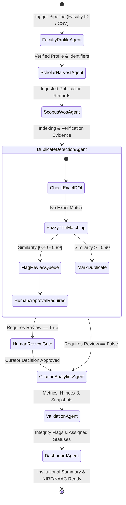

# Multi-Agent Workflow Specification

## Overview

The **Research Intelligence & Publication Analytics Portal** operates as an autonomous multi-agent system orchestrated through **LangGraph**. The workflow comprises seven specialized, decoupled AI worklets that execute sequentially or conditionally to harvest, verify, deduplicate, validate, and compute analytics on scholarly publications.

---

## 1. Multi-Agent Topology & State Graph



---

## 2. Shared State Schema (`AgentState`)

All seven agents communicate using a unified state dictionary (`AgentState` TypedDict). Nodes mutate state deterministically:

```python
class AgentState(TypedDict, total=False):
    # Execution Metadata
    execution_id: str
    triggered_by: Optional[str]
    current_agent: str
    status: str
    errors: List[Dict[str, Any]]
    logs: List[Dict[str, Any]]

    # 1. Faculty Profile Agent
    faculty_id: Optional[str]
    faculty_profile: Optional[Dict[str, Any]]
    faculty_identifiers: Optional[Dict[str, Any]]
    identity_conflicts: List[Dict[str, Any]]

    # 2. Google Scholar Harvest Agent
    scholar_harvest_source: Optional[str]
    scholar_csv_content: Optional[str]
    harvested_publications: List[Dict[str, Any]]
    harvest_summary: Optional[Dict[str, Any]]

    # 3. Scopus / WoS Verification Agent
    verification_targets: List[Dict[str, Any]]
    verification_results: List[Dict[str, Any]]
    unverified_publications: List[Dict[str, Any]]

    # 4. Duplicate Detection Agent
    duplicate_candidates: List[Dict[str, Any]]
    deduplicated_publications: List[Dict[str, Any]]
    human_review_required: bool
    review_queue: List[Dict[str, Any]]

    # 5. Citation Analytics Agent
    citation_metrics: Optional[Dict[str, Any]]
    yearly_citations: List[Dict[str, Any]]
    department_metrics: Optional[Dict[str, Any]]

    # 6. Validation Agent
    validation_results: List[Dict[str, Any]]
    validation_status_counts: Dict[str, int]
    flagged_records: List[Dict[str, Any]]

    # 7. Dashboard Agent
    dashboard_analytics: Optional[Dict[str, Any]]
    nirf_report_data: Optional[Dict[str, Any]]
    naac_report_data: Optional[Dict[str, Any]]
    export_payload: Optional[Dict[str, Any]]
```

---

## 3. Node Definitions & Responsibilities

### Agent 1: Faculty Profile Agent (`faculty_profile_node`)
- **Inputs**: `faculty_id`, `email`, or scholarly profile identifiers.
- **Outputs**: Resolved institutional profile, ORCID verification, homonym/identity conflict checks.
- **Failure Policy**: If identity conflicts exceed threshold, marks `status="CONFLICT"` and halts downstream automated harvesting until coordinator approval.

### Agent 2: Google Scholar Harvest Agent (`scholar_harvest_node`)
- **Inputs**: `scholar_id` or uploaded `scholar_csv_content`.
- **Outputs**: Array of raw `harvested_publications` with normalized titles, authors, years, and provenance timestamp.
- **Provenance Rule**: Every publication stores its source origin, retrieval timestamp, and raw payload.

### Agent 3: Scopus / Web of Science Verification Agent (`scopus_wos_node`)
- **Inputs**: `harvested_publications` list with DOIs and titles.
- **Outputs**: `verification_results` with cryptographic or official API evidence, `scopus_eid`, `wos_uid`.
- **Integrity Rule**: Never claim verification without live API response or manual curator confirmation. When API keys are absent, marks `unverified` and flags for manual review.

### Agent 4: Duplicate Detection Agent (`duplicate_detection_node`)
- **Inputs**: `harvested_publications` and existing database records.
- **Outputs**: `deduplicated_publications`, `duplicate_candidates`, `review_queue`.
- **Matching Tiers**:
  1. Exact normalized DOI match (100% confidence).
  2. Levenshtein fuzzy title match:
     - $\ge 0.90$: Auto-merged as duplicate.
     - $0.70 \le \text{ratio} < 0.90$: Enqueued to human review gate.
     - $< 0.70$: Distinct publication.

### Agent 5: Citation Analytics Agent (`citation_analytics_node`)
- **Inputs**: `deduplicated_publications`.
- **Outputs**: `citation_metrics` (Total Publications, Total Citations, $h$-index, $i10$-index), yearly citation distribution.
- **Formulas**:
  - **$h$-index**: Maximum $h$ such that $h$ publications each have at least $h$ citations.
  - **$i10$-index**: Count of publications with at least 10 citations.

### Agent 6: Validation Agent (`validation_node`)
- **Inputs**: `deduplicated_publications` and `verification_results`.
- **Outputs**: `validation_results` with assigned publication statuses:
  - `verified`: Indexed in Scopus/WoS or valid DOI with matching metadata.
  - `partially_verified`: Validated author/year but missing standard DOI indexing.
  - `unverified`: No third-party indexing evidence found.
  - `duplicate`: Confirmed copy of another institutional record.
  - `requires_review`: Conflicting metadata, malformed DOI, or anomalous year.

### Agent 7: Dashboard Agent (`dashboard_node`)
- **Inputs**: Aggregated metrics, status distribution, and yearly trends.
- **Outputs**: Structured analytical payloads formatted for NIRF (RPC Parameter 3) and NAAC (Criterion 3.4) accreditation exports.

---

## 4. Human-in-the-Loop Approval Mechanism

Uncertain duplicate pairs or conflicting author attributions route to an asynchronous review table (`duplicate_candidates` with status `needs_review`). 

Research Coordinators or Administrators review these via the web portal:
- **Approve Duplicate**: Merges citation counts and designates primary canonical record.
- **Reject Duplicate**: Declares distinct publications and unlinks candidates.
- **Edit Metadata**: Adjusts conflicting DOIs or titles before rerunning verification.
