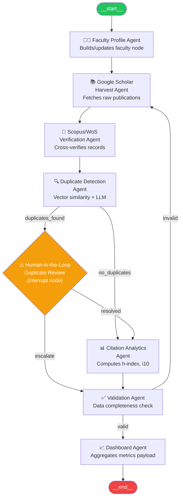
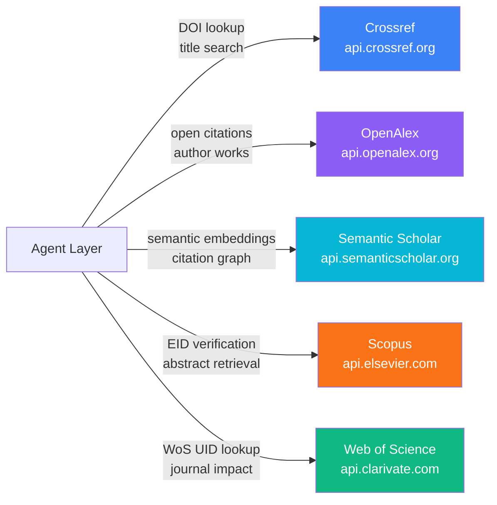
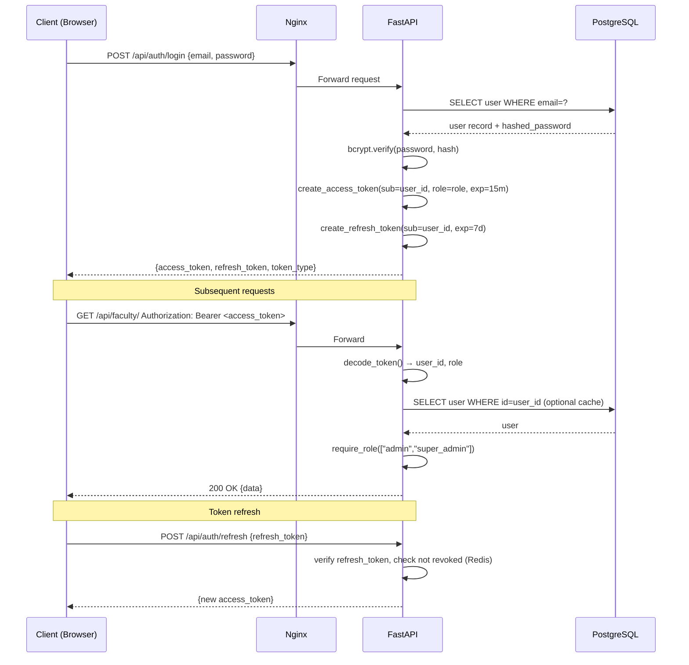
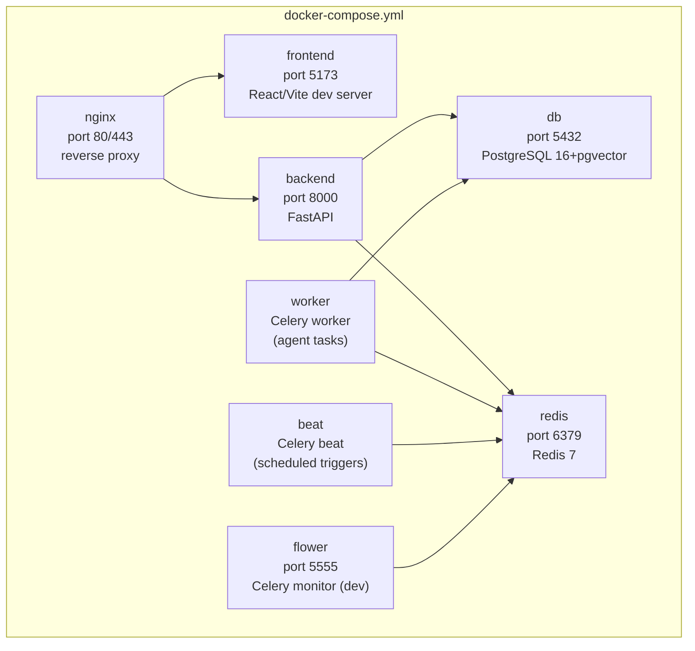

# System Architecture
## Research Intelligence & Publication Analytics Portal (RIPAP)

---

## Table of Contents
1. [High-Level Overview](#1-high-level-overview)
2. [Layer Breakdown](#2-layer-breakdown)
3. [LangGraph Multi-Agent Topology](#3-langgraph-multi-agent-topology)
4. [External API Integrations](#4-external-api-integrations)
5. [JWT Auth Flow & RBAC](#5-jwt-auth-flow--rbac)
6. [Docker Compose Service Topology](#6-docker-compose-service-topology)
7. [Data Flow Walkthrough](#7-data-flow-walkthrough)

---

## 1. High-Level Overview

```
┌─────────────────────────────────────────────────────────────────────────┐
│                            BROWSER / CLIENT                             │
│          React 18 + Vite + Tailwind CSS + Recharts + shadcn/ui          │
└───────────────────────────────┬─────────────────────────────────────────┘
                                │  HTTPS / WebSocket
                                ▼
┌─────────────────────────────────────────────────────────────────────────┐
│                         NGINX REVERSE PROXY                             │
│                   (TLS termination, static assets)                      │
└───────────────────────────────┬─────────────────────────────────────────┘
                                │
                                ▼
┌─────────────────────────────────────────────────────────────────────────┐
│                        FASTAPI BACKEND (port 8000)                      │
│  ┌─────────────┐  ┌────────────┐  ┌───────────────┐  ┌──────────────┐  │
│  │  Auth Router│  │ Faculty API│  │Publication API│  │  Agent API   │  │
│  │  /auth/*    │  │ /faculty/* │  │ /publications/│  │ /agents/*    │  │
│  └─────────────┘  └────────────┘  └───────────────┘  └──────────────┘  │
│  ┌─────────────┐  ┌────────────┐                                        │
│  │Analytics API│  │ Reports API│                                        │
│  │/analytics/* │  │ /reports/* │                                        │
│  └─────────────┘  └────────────┘                                        │
│                                                                         │
│         ┌─────────────────────────────────────────┐                    │
│         │        LANGGRAPH AGENT COORDINATOR       │                    │
│         │   (Stateful graph, async execution)      │                    │
│         └─────────────────────────────────────────┘                    │
└──────────────────────────┬──────────────────────────────────────────────┘
                           │  SQLAlchemy async sessions
          ┌────────────────┼────────────────────┐
          ▼                ▼                    ▼
┌──────────────┐   ┌──────────────┐   ┌──────────────────┐
│ PostgreSQL 16│   │   Redis 7    │   │  External APIs   │
│  + pgvector  │   │  (Cache/MQ)  │   │  Crossref        │
│  port 5432   │   │  port 6379   │   │  OpenAlex        │
└──────────────┘   └──────────────┘   │  Semantic Scholar│
                                       │  Scopus          │
                                       │  Web of Science  │
                                       └──────────────────┘
```

---

## 2. Layer Breakdown

### 2.1 Frontend Layer — React + Vite + Tailwind + Recharts

```
frontend/src/
├── pages/
│   ├── LoginPage.tsx           ← JWT login form
│   ├── DashboardPage.tsx       ← Main analytics dashboard
│   ├── FacultyListPage.tsx     ← Faculty directory with search
│   ├── FacultyDetailPage.tsx   ← Individual faculty profile + publications
│   ├── PublicationsPage.tsx    ← Publication browser with filters
│   ├── AgentStatusPage.tsx     ← Real-time agent execution monitor
│   ├── DuplicatesPage.tsx      ← Human-in-the-loop duplicate resolution UI
│   ├── ReportsPage.tsx         ← NIRF/NAAC report generation
│   └── AdminPage.tsx           ← User & system management (Super Admin)
│
├── components/
│   ├── charts/                 ← Recharts wrappers (citation trends, h-index)
│   ├── tables/                 ← TanStack Table publication grids
│   ├── agent/                  ← Agent log live feed, status badges
│   └── layout/                 ← Sidebar, Topbar, BreadcrumbNav
│
├── stores/
│   ├── authStore.ts            ← Zustand: JWT tokens, user info
│   └── agentStore.ts           ← Zustand: active agent run state
│
└── api/
    ├── axiosClient.ts          ← Axios with interceptors (JWT refresh)
    └── endpoints/              ← Typed API call functions per domain
```

**Key design decisions:**
- TanStack Query manages server-state caching and invalidation
- WebSocket connection to `/ws/agents/{run_id}` streams live agent logs
- Zod schemas mirror backend Pydantic models for type safety

---

### 2.2 Backend Layer — FastAPI

```
backend/app/
├── main.py                     ← App factory, middleware, router registration
├── config.py                   ← Pydantic BaseSettings from .env
├── database.py                 ← Async SQLAlchemy engine + session factory
│
├── models/                     ← SQLAlchemy ORM models (see DATABASE_SCHEMA.md)
├── schemas/                    ← Pydantic v2 request/response models
├── routers/                    ← Thin HTTP layer (validation → service)
├── services/                   ← Business logic (publication service, etc.)
├── auth/
│   ├── jwt.py                  ← Token creation, decode, refresh
│   ├── dependencies.py         ← get_current_user(), require_role()
│   └── password.py             ← bcrypt hashing
├── agents/                     ← LangGraph agent modules
├── integrations/               ← External API async clients
├── tasks/                      ← Celery tasks (wrap agent runs)
└── utils/
    ├── pagination.py
    ├── vector.py               ← pgvector helpers
    └── export.py               ← PDF/Excel generators
```

**Middleware stack (order):**
1. `CORSMiddleware` — configured from `CORS_ORIGINS`
2. `TrustedHostMiddleware` — allow-listed hostnames
3. `GZipMiddleware` — compress responses > 1 KB
4. Custom `RequestLoggingMiddleware` — structured JSON logs
5. `SlowAPIMiddleware` — rate limiting per IP (via Redis)

---

### 2.3 Database Layer — PostgreSQL + pgvector

- **PostgreSQL 16** with the `pgvector` extension for 1536-dimensional embedding storage
- **SQLAlchemy 2.0** async engine (`asyncpg` driver)
- **Alembic** for schema migrations
- **HNSW index** on `publications.embedding` for fast cosine similarity search

See [DATABASE_SCHEMA.md](DATABASE_SCHEMA.md) for the full schema.

---

## 3. LangGraph Multi-Agent Topology

### 3.1 Agent Graph Diagram



### 3.2 Agent Descriptions

| Agent | Node Key | Input State Fields | Output State Fields |
|-------|----------|--------------------|---------------------|
| **Faculty Profile Agent** | `faculty_profile` | `faculty_id`, `run_config` | `faculty_data`, `profile_status` |
| **Google Scholar Harvest Agent** | `scholar_harvest` | `faculty_data` | `raw_publications`, `harvest_errors` |
| **Scopus/WoS Verification Agent** | `scopus_wos_verify` | `raw_publications` | `verified_publications`, `unverified_list` |
| **Duplicate Detection Agent** | `duplicate_detection` | `verified_publications` | `duplicates`, `unique_publications` |
| **Citation Analytics Agent** | `citation_analytics` | `unique_publications`, `faculty_data` | `citation_metrics`, `h_index`, `i10_index` |
| **Validation Agent** | `validation` | `citation_metrics`, `unique_publications` | `validation_report`, `is_valid` |
| **Dashboard Agent** | `dashboard` | `citation_metrics`, `validation_report` | `dashboard_payload`, `summary` |

### 3.3 Coordinator (Graph Builder)

```python
# agents/coordinator.py (outline)
from langgraph.graph import StateGraph, END
from langgraph.checkpoint.postgres import PostgresSaver

graph = StateGraph(AgentState)

graph.add_node("faculty_profile",    faculty_profile_agent)
graph.add_node("scholar_harvest",    scholar_harvest_agent)
graph.add_node("scopus_wos_verify",  scopus_wos_agent)
graph.add_node("duplicate_detection",duplicate_detection_agent)
graph.add_node("hitl_review",        hitl_review_node)   # interrupt()
graph.add_node("citation_analytics", citation_analytics_agent)
graph.add_node("validation",         validation_agent)
graph.add_node("dashboard",          dashboard_agent)

graph.set_entry_point("faculty_profile")
graph.add_edge("faculty_profile",     "scholar_harvest")
graph.add_edge("scholar_harvest",     "scopus_wos_verify")
graph.add_edge("scopus_wos_verify",   "duplicate_detection")
graph.add_conditional_edges("duplicate_detection", route_duplicates,
    {"hitl": "hitl_review", "clear": "citation_analytics"})
graph.add_conditional_edges("hitl_review", route_hitl,
    {"resolved": "citation_analytics", "escalate": "validation"})
graph.add_edge("citation_analytics",  "validation")
graph.add_conditional_edges("validation", route_validation,
    {"valid": "dashboard", "retry": "scholar_harvest"})
graph.add_edge("dashboard", END)

checkpointer = PostgresSaver.from_conn_string(DATABASE_URL)
app = graph.compile(checkpointer=checkpointer, interrupt_before=["hitl_review"])
```

---

## 4. External API Integrations



| Integration | Rate Limits | Retry Strategy | Key Fields Retrieved |
|-------------|-------------|----------------|---------------------|
| **Crossref** | 50 req/s (polite pool) | Exponential backoff × 3 | DOI, title, authors, journal, year, citations |
| **OpenAlex** | 100,000 req/day | Backoff + cursor pagination | OA ID, works, concepts, cited_by_count |
| **Semantic Scholar** | 1 req/s (free), 100/s (key) | Queue + backoff | Paper ID, embedding, citations, references |
| **Scopus** | Institutional quota | Backoff + 429 respect | EID, ISSN, SJR, subject areas |
| **Web of Science** | Institutional quota | Backoff + 429 respect | UT (WoS ID), impact factor, quartile |

---

## 5. JWT Auth Flow & RBAC

### 5.1 Auth Flow



### 5.2 RBAC Permission Matrix

| Endpoint Group | Super Admin | Admin | Faculty | Viewer |
|----------------|:-----------:|:-----:|:-------:|:------:|
| Auth (login/logout) | ✅ | ✅ | ✅ | ✅ |
| User management | ✅ | ❌ | ❌ | ❌ |
| Faculty CRUD | ✅ | ✅ (own dept) | ✅ (own) | 👁️ |
| Publication CRUD | ✅ | ✅ | ✅ (own) | 👁️ |
| Agent trigger | ✅ | ✅ | ❌ | ❌ |
| Agent logs | ✅ | ✅ | ❌ | ❌ |
| Duplicate review | ✅ | ✅ | ❌ | ❌ |
| Analytics view | ✅ | ✅ | ✅ (own) | ✅ |
| Report generation | ✅ | ✅ | ❌ | 👁️ |
| System settings | ✅ | ❌ | ❌ | ❌ |

> ✅ = full access · 👁️ = read-only · ❌ = denied

### 5.3 JWT Token Structure

```json
{
  "sub": "usr_01HXYZ...",
  "email": "john.doe@university.edu",
  "role": "admin",
  "department_id": "dept_01HABC...",
  "iat": 1700000000,
  "exp": 1700000900,
  "jti": "tok_01HDEF..."
}
```

---

## 6. Docker Compose Service Topology



### Service Definitions Summary

| Service | Image | Ports | Depends On | Health Check |
|---------|-------|-------|------------|--------------|
| `db` | `pgvector/pgvector:pg16` | 5432 | — | `pg_isready` |
| `redis` | `redis:7-alpine` | 6379 | — | `redis-cli ping` |
| `backend` | `./backend` (custom) | 8000 | db, redis | `GET /health` |
| `worker` | `./backend` (custom) | — | db, redis | `celery inspect ping` |
| `beat` | `./backend` (custom) | — | redis | — |
| `frontend` | `./frontend` (custom) | 5173 | backend | `wget /` |
| `nginx` | `nginx:alpine` | 80, 443 | frontend, backend | — |
| `flower` | `mher/flower` | 5555 | redis | — |

---

## 7. Data Flow Walkthrough

### Full Publication Harvest Run

```
1. Admin clicks "Run Harvest" for Faculty X in the UI
2. Frontend → POST /api/agents/trigger {faculty_id, agent_type: "full_harvest"}
3. FastAPI creates AgentExecution record (status=PENDING) → returns execution_id
4. FastAPI pushes Celery task to Redis queue
5. Celery worker picks up task → runs LangGraph graph.ainvoke(state)
6. Faculty Profile Agent: loads faculty from DB, enriches profile data
7. Scholar Harvest Agent: queries Google Scholar / SerpAPI → raw publication list
8. Scopus/WoS Agent: for each DOI, calls Scopus + WoS APIs → verified records
9. Duplicate Detection Agent:
   a. Generates embeddings via Semantic Scholar API
   b. Stores embeddings in pgvector column
   c. Runs: SELECT ... ORDER BY embedding <=> query_embedding LIMIT 10
   d. LLM adjudicates borderline pairs → flags duplicates
10. If duplicates: graph INTERRUPTS → agent execution paused (status=AWAITING_REVIEW)
    WebSocket pushes "review_required" event to frontend
    Admin resolves in UI → POST /api/agents/{id}/resume {resolution}
11. Citation Analytics Agent: pulls citation counts from OpenAlex + Crossref
    Computes h-index, i10-index → saves CitationSnapshot
12. Validation Agent: checks for missing DOIs, year anomalies, author mismatches
13. Dashboard Agent: aggregates dept-level and faculty-level metrics → cache in Redis
14. AgentExecution status → COMPLETED
15. WebSocket sends "run_complete" → frontend refreshes dashboard
```
