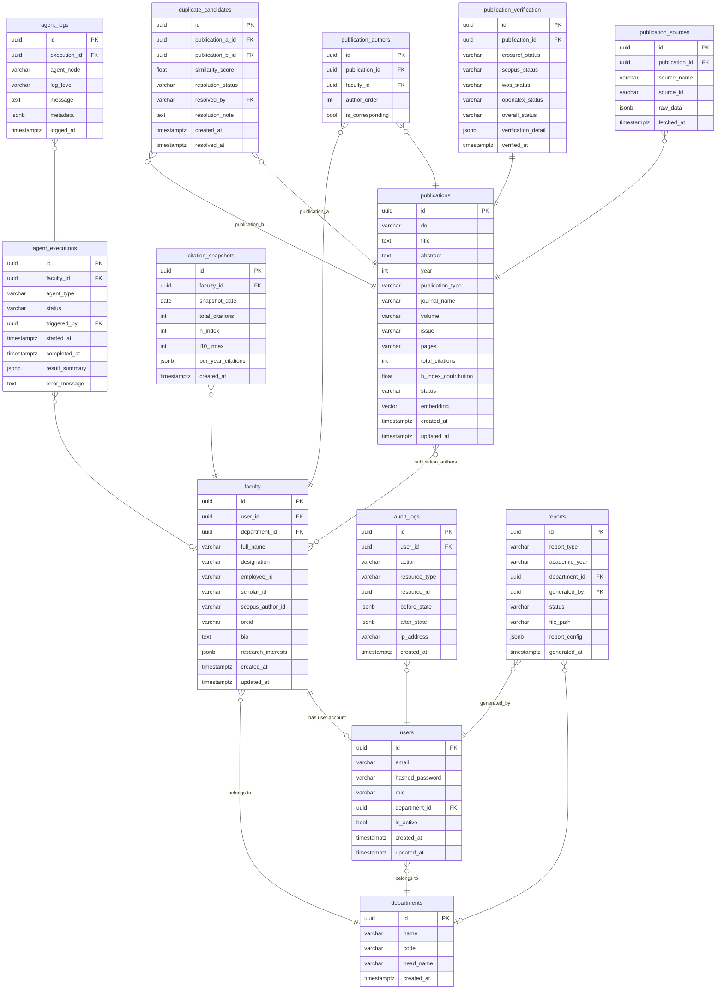

# Database Schema Reference
## Research Intelligence & Publication Analytics Portal (RIPAP)

> **Database:** PostgreSQL 16 + pgvector extension  
> **ORM:** SQLAlchemy 2.0 (async)  
> **Migrations:** Alembic

---

## Table of Contents
1. [Entity Relationship Diagram](#1-entity-relationship-diagram)
2. [Table Definitions](#2-table-definitions)
   - [users](#21-users)
   - [departments](#22-departments)
   - [faculty](#23-faculty)
   - [publications](#24-publications)
   - [publication_authors](#25-publication_authors)
   - [publication_sources](#26-publication_sources)
   - [publication_verification](#27-publication_verification)
   - [duplicate_candidates](#28-duplicate_candidates)
   - [citation_snapshots](#29-citation_snapshots)
   - [agent_executions](#210-agent_executions)
   - [agent_logs](#211-agent_logs)
   - [audit_logs](#212-audit_logs)
   - [reports](#213-reports)
3. [Indexes Summary](#3-indexes-summary)
4. [Relationships Summary](#4-relationships-summary)
5. [pgvector Setup](#5-pgvector-setup)

---

## 1. Entity Relationship Diagram



---

## 2. Table Definitions

### 2.1 `users`

Stores authentication credentials and role assignments for all system users.

| Column | Type | Constraints | Description |
|--------|------|-------------|-------------|
| `id` | `UUID` | PK, default `gen_random_uuid()` | Surrogate primary key |
| `email` | `VARCHAR(320)` | NOT NULL, UNIQUE | User login email |
| `hashed_password` | `VARCHAR(255)` | NOT NULL | bcrypt hash |
| `role` | `VARCHAR(20)` | NOT NULL, CHECK IN ('super_admin','admin','faculty','viewer') | RBAC role |
| `department_id` | `UUID` | FK → departments.id, NULLABLE | Scopes admin/faculty to a department |
| `is_active` | `BOOLEAN` | NOT NULL, DEFAULT TRUE | Soft-disable flag |
| `last_login_at` | `TIMESTAMPTZ` | NULLABLE | Last successful login |
| `created_at` | `TIMESTAMPTZ` | NOT NULL, DEFAULT NOW() | Record creation timestamp |
| `updated_at` | `TIMESTAMPTZ` | NOT NULL, DEFAULT NOW() | Auto-updated via trigger |

**Indexes:**
```sql
CREATE UNIQUE INDEX ix_users_email ON users(email);
CREATE INDEX ix_users_department_id ON users(department_id);
CREATE INDEX ix_users_role ON users(role);
```

---

### 2.2 `departments`

Academic departments / schools within the institution.

| Column | Type | Constraints | Description |
|--------|------|-------------|-------------|
| `id` | `UUID` | PK, default `gen_random_uuid()` | Surrogate primary key |
| `name` | `VARCHAR(255)` | NOT NULL, UNIQUE | Full department name |
| `code` | `VARCHAR(20)` | NOT NULL, UNIQUE | Short code (e.g., `CSE`, `ECE`) |
| `head_name` | `VARCHAR(255)` | NULLABLE | Current HOD name |
| `head_faculty_id` | `UUID` | FK → faculty.id, NULLABLE | HOD faculty record |
| `is_active` | `BOOLEAN` | NOT NULL, DEFAULT TRUE | Active flag |
| `created_at` | `TIMESTAMPTZ` | NOT NULL, DEFAULT NOW() | |
| `updated_at` | `TIMESTAMPTZ` | NOT NULL, DEFAULT NOW() | |

**Indexes:**
```sql
CREATE UNIQUE INDEX ix_departments_code ON departments(code);
```

---

### 2.3 `faculty`

Extended profile information for each researcher/faculty member.

| Column | Type | Constraints | Description |
|--------|------|-------------|-------------|
| `id` | `UUID` | PK, default `gen_random_uuid()` | Surrogate primary key |
| `user_id` | `UUID` | FK → users.id, UNIQUE, NULLABLE | Linked login account (optional) |
| `department_id` | `UUID` | FK → departments.id, NOT NULL | Home department |
| `full_name` | `VARCHAR(255)` | NOT NULL | Full display name |
| `first_name` | `VARCHAR(100)` | NOT NULL | First / given name |
| `last_name` | `VARCHAR(100)` | NOT NULL | Last / family name |
| `designation` | `VARCHAR(100)` | NULLABLE | e.g., "Associate Professor" |
| `employee_id` | `VARCHAR(50)` | UNIQUE, NULLABLE | Institutional employee ID |
| `email` | `VARCHAR(320)` | NULLABLE | Institutional email |
| `phone` | `VARCHAR(20)` | NULLABLE | |
| `scholar_id` | `VARCHAR(50)` | NULLABLE | Google Scholar profile ID |
| `scopus_author_id` | `VARCHAR(50)` | NULLABLE | Scopus Author ID |
| `orcid` | `VARCHAR(25)` | NULLABLE | ORCID iD (e.g., 0000-0001-2345-6789) |
| `wos_researcher_id` | `VARCHAR(50)` | NULLABLE | Web of Science Researcher ID |
| `bio` | `TEXT` | NULLABLE | Short professional biography |
| `research_interests` | `JSONB` | NULLABLE, DEFAULT '[]' | Array of research topic strings |
| `profile_image_url` | `VARCHAR(500)` | NULLABLE | URL to profile photo |
| `join_date` | `DATE` | NULLABLE | Date joined institution |
| `is_active` | `BOOLEAN` | NOT NULL, DEFAULT TRUE | |
| `created_at` | `TIMESTAMPTZ` | NOT NULL, DEFAULT NOW() | |
| `updated_at` | `TIMESTAMPTZ` | NOT NULL, DEFAULT NOW() | |

**Indexes:**
```sql
CREATE UNIQUE INDEX ix_faculty_user_id ON faculty(user_id) WHERE user_id IS NOT NULL;
CREATE UNIQUE INDEX ix_faculty_employee_id ON faculty(employee_id) WHERE employee_id IS NOT NULL;
CREATE INDEX ix_faculty_department_id ON faculty(department_id);
CREATE INDEX ix_faculty_scholar_id ON faculty(scholar_id);
CREATE INDEX ix_faculty_scopus_id ON faculty(scopus_author_id);
CREATE INDEX ix_faculty_name_trgm ON faculty USING GIN (full_name gin_trgm_ops);
```

---

### 2.4 `publications`

Core bibliographic record for each distinct publication.

| Column | Type | Constraints | Description |
|--------|------|-------------|-------------|
| `id` | `UUID` | PK, default `gen_random_uuid()` | Surrogate primary key |
| `doi` | `VARCHAR(255)` | UNIQUE, NULLABLE | Digital Object Identifier |
| `title` | `TEXT` | NOT NULL | Full publication title |
| `abstract` | `TEXT` | NULLABLE | Abstract text |
| `year` | `SMALLINT` | NOT NULL | Publication year |
| `publication_type` | `VARCHAR(50)` | NOT NULL, CHECK IN ('journal_article','conference_paper','book_chapter','book','patent','thesis','preprint','other') | Type classification |
| `journal_name` | `VARCHAR(500)` | NULLABLE | Journal / conference / book name |
| `publisher` | `VARCHAR(255)` | NULLABLE | Publishing organisation |
| `issn` | `VARCHAR(20)` | NULLABLE | Print ISSN |
| `eissn` | `VARCHAR(20)` | NULLABLE | Electronic ISSN |
| `isbn` | `VARCHAR(20)` | NULLABLE | Book ISBN |
| `volume` | `VARCHAR(20)` | NULLABLE | Journal volume |
| `issue` | `VARCHAR(20)` | NULLABLE | Journal issue |
| `pages` | `VARCHAR(50)` | NULLABLE | Page range (e.g., "123–145") |
| `article_number` | `VARCHAR(50)` | NULLABLE | Article number (some journals) |
| `language` | `VARCHAR(10)` | DEFAULT 'en' | ISO 639-1 language code |
| `keywords` | `JSONB` | DEFAULT '[]' | Extracted keyword array |
| `subjects` | `JSONB` | DEFAULT '[]' | Subject / discipline classification |
| `open_access` | `BOOLEAN` | DEFAULT FALSE | OA status |
| `total_citations` | `INTEGER` | NOT NULL, DEFAULT 0 | Aggregated citation count |
| `crossref_citations` | `INTEGER` | NULLABLE | Crossref-sourced count |
| `scopus_citations` | `INTEGER` | NULLABLE | Scopus-sourced count |
| `wos_citations` | `INTEGER` | NULLABLE | WoS-sourced count |
| `openalex_citations` | `INTEGER` | NULLABLE | OpenAlex-sourced count |
| `status` | `VARCHAR(30)` | NOT NULL, DEFAULT 'pending', CHECK IN ('pending','verified','unverified','duplicate','rejected') | Workflow status |
| `is_duplicate` | `BOOLEAN` | NOT NULL, DEFAULT FALSE | Marked as duplicate |
| `canonical_id` | `UUID` | FK → publications.id, NULLABLE | Points to canonical record if duplicate |
| `embedding` | `VECTOR(1536)` | NULLABLE | Semantic embedding for similarity search |
| `created_at` | `TIMESTAMPTZ` | NOT NULL, DEFAULT NOW() | |
| `updated_at` | `TIMESTAMPTZ` | NOT NULL, DEFAULT NOW() | |

**Indexes:**
```sql
CREATE UNIQUE INDEX ix_publications_doi ON publications(doi) WHERE doi IS NOT NULL;
CREATE INDEX ix_publications_year ON publications(year);
CREATE INDEX ix_publications_status ON publications(status);
CREATE INDEX ix_publications_type ON publications(publication_type);
CREATE INDEX ix_publications_title_trgm ON publications USING GIN (title gin_trgm_ops);
-- pgvector HNSW index for fast approximate nearest-neighbour search
CREATE INDEX ix_publications_embedding_hnsw
    ON publications USING hnsw (embedding vector_cosine_ops)
    WITH (m = 16, ef_construction = 64);
```

---

### 2.5 `publication_authors`

Junction table linking publications to faculty (many-to-many).

| Column | Type | Constraints | Description |
|--------|------|-------------|-------------|
| `id` | `UUID` | PK | |
| `publication_id` | `UUID` | FK → publications.id, NOT NULL | |
| `faculty_id` | `UUID` | FK → faculty.id, NULLABLE | NULL if external/non-faculty author |
| `external_author_name` | `VARCHAR(255)` | NULLABLE | Name for non-faculty authors |
| `external_author_affiliation` | `VARCHAR(500)` | NULLABLE | Affiliation string |
| `author_order` | `SMALLINT` | NOT NULL | 1-based author position |
| `is_corresponding` | `BOOLEAN` | NOT NULL, DEFAULT FALSE | Corresponding author flag |
| `created_at` | `TIMESTAMPTZ` | NOT NULL, DEFAULT NOW() | |

**Indexes:**
```sql
CREATE INDEX ix_pub_authors_publication_id ON publication_authors(publication_id);
CREATE INDEX ix_pub_authors_faculty_id ON publication_authors(faculty_id) WHERE faculty_id IS NOT NULL;
CREATE UNIQUE INDEX ix_pub_authors_unique ON publication_authors(publication_id, author_order);
```

---

### 2.6 `publication_sources`

Raw data snapshots from each harvesting source, preserving provenance.

| Column | Type | Constraints | Description |
|--------|------|-------------|-------------|
| `id` | `UUID` | PK | |
| `publication_id` | `UUID` | FK → publications.id, NOT NULL | |
| `source_name` | `VARCHAR(50)` | NOT NULL, CHECK IN ('crossref','openalex','semantic_scholar','scopus','web_of_science','google_scholar','manual') | Source identifier |
| `source_id` | `VARCHAR(255)` | NULLABLE | Record ID in the source system |
| `source_url` | `VARCHAR(1000)` | NULLABLE | Direct link to source record |
| `raw_data` | `JSONB` | NOT NULL | Complete API response JSON |
| `fetched_at` | `TIMESTAMPTZ` | NOT NULL, DEFAULT NOW() | When data was fetched |

**Indexes:**
```sql
CREATE INDEX ix_pub_sources_publication_id ON publication_sources(publication_id);
CREATE UNIQUE INDEX ix_pub_sources_unique ON publication_sources(publication_id, source_name);
```

---

### 2.7 `publication_verification`

Tracks cross-source verification outcome per publication.

| Column | Type | Constraints | Description |
|--------|------|-------------|-------------|
| `id` | `UUID` | PK | |
| `publication_id` | `UUID` | FK → publications.id, NOT NULL, UNIQUE | One verification record per publication |
| `crossref_status` | `VARCHAR(20)` | CHECK IN ('found','not_found','error','skipped') | |
| `scopus_status` | `VARCHAR(20)` | CHECK IN ('found','not_found','error','skipped') | |
| `wos_status` | `VARCHAR(20)` | CHECK IN ('found','not_found','error','skipped') | |
| `openalex_status` | `VARCHAR(20)` | CHECK IN ('found','not_found','error','skipped') | |
| `semantic_scholar_status` | `VARCHAR(20)` | CHECK IN ('found','not_found','error','skipped') | |
| `overall_status` | `VARCHAR(20)` | NOT NULL, CHECK IN ('verified','partial','unverified','failed') | Derived overall status |
| `confidence_score` | `FLOAT` | CHECK BETWEEN 0 AND 1 | 0.0–1.0 confidence in verification |
| `verification_detail` | `JSONB` | NULLABLE | Per-source detail object |
| `verified_at` | `TIMESTAMPTZ` | NULLABLE | When verification completed |
| `verified_by_agent` | `UUID` | FK → agent_executions.id, NULLABLE | Which execution verified this |

**Indexes:**
```sql
CREATE UNIQUE INDEX ix_pub_verification_publication_id ON publication_verification(publication_id);
CREATE INDEX ix_pub_verification_overall_status ON publication_verification(overall_status);
```

---

### 2.8 `duplicate_candidates`

Pairs of publications flagged as potential duplicates, with resolution tracking.

| Column | Type | Constraints | Description |
|--------|------|-------------|-------------|
| `id` | `UUID` | PK | |
| `publication_a_id` | `UUID` | FK → publications.id, NOT NULL | First publication (lower UUID first by convention) |
| `publication_b_id` | `UUID` | FK → publications.id, NOT NULL | Second publication |
| `similarity_score` | `FLOAT` | NOT NULL, CHECK BETWEEN 0 AND 1 | Cosine similarity score |
| `detection_method` | `VARCHAR(50)` | NOT NULL, CHECK IN ('vector_similarity','title_fuzzy','doi_match','llm_adjudicated') | How the pair was detected |
| `llm_reasoning` | `TEXT` | NULLABLE | LLM explanation for flagging |
| `resolution_status` | `VARCHAR(20)` | NOT NULL, DEFAULT 'pending', CHECK IN ('pending','confirmed_duplicate','false_positive','merged','escalated') | |
| `resolved_by` | `UUID` | FK → users.id, NULLABLE | User who made resolution decision |
| `resolution_note` | `TEXT` | NULLABLE | Admin note |
| `created_at` | `TIMESTAMPTZ` | NOT NULL, DEFAULT NOW() | |
| `resolved_at` | `TIMESTAMPTZ` | NULLABLE | When resolution was made |

**Indexes:**
```sql
CREATE UNIQUE INDEX ix_dup_candidates_pair ON duplicate_candidates(
    LEAST(publication_a_id, publication_b_id),
    GREATEST(publication_a_id, publication_b_id)
);
CREATE INDEX ix_dup_candidates_status ON duplicate_candidates(resolution_status);
CREATE INDEX ix_dup_candidates_score ON duplicate_candidates(similarity_score DESC);
```

---

### 2.9 `citation_snapshots`

Point-in-time citation metric snapshots per faculty member (time-series).

| Column | Type | Constraints | Description |
|--------|------|-------------|-------------|
| `id` | `UUID` | PK | |
| `faculty_id` | `UUID` | FK → faculty.id, NOT NULL | |
| `snapshot_date` | `DATE` | NOT NULL | Date of snapshot |
| `total_citations` | `INTEGER` | NOT NULL, DEFAULT 0 | Total citations across all publications |
| `h_index` | `SMALLINT` | NOT NULL, DEFAULT 0 | Hirsch index |
| `i10_index` | `SMALLINT` | NOT NULL, DEFAULT 0 | i10-index (papers with ≥10 citations) |
| `total_publications` | `SMALLINT` | NOT NULL, DEFAULT 0 | Total verified publication count |
| `per_year_citations` | `JSONB` | NULLABLE | `{"2020": 12, "2021": 18, ...}` |
| `citation_sources` | `JSONB` | NULLABLE | Breakdown by source |
| `computed_by_execution_id` | `UUID` | FK → agent_executions.id, NULLABLE | |
| `created_at` | `TIMESTAMPTZ` | NOT NULL, DEFAULT NOW() | |

**Indexes:**
```sql
CREATE UNIQUE INDEX ix_citation_snapshots_faculty_date ON citation_snapshots(faculty_id, snapshot_date);
CREATE INDEX ix_citation_snapshots_faculty_id ON citation_snapshots(faculty_id);
CREATE INDEX ix_citation_snapshots_date ON citation_snapshots(snapshot_date DESC);
```

---

### 2.10 `agent_executions`

Tracks each LangGraph agent run from trigger to completion.

| Column | Type | Constraints | Description |
|--------|------|-------------|-------------|
| `id` | `UUID` | PK | Also used as LangGraph thread_id |
| `faculty_id` | `UUID` | FK → faculty.id, NULLABLE | Target faculty (NULL = department/global run) |
| `department_id` | `UUID` | FK → departments.id, NULLABLE | Target department |
| `agent_type` | `VARCHAR(50)` | NOT NULL, CHECK IN ('full_harvest','scholar_only','verify_only','citation_update','dedup_scan','validation','dashboard_refresh') | |
| `status` | `VARCHAR(30)` | NOT NULL, DEFAULT 'pending', CHECK IN ('pending','running','awaiting_review','completed','failed','cancelled') | Execution lifecycle |
| `triggered_by` | `UUID` | FK → users.id, NULLABLE | NULL = scheduled |
| `celery_task_id` | `VARCHAR(255)` | NULLABLE | Celery async result ID |
| `graph_state` | `JSONB` | NULLABLE | Last serialised LangGraph state |
| `result_summary` | `JSONB` | NULLABLE | Key metrics from run |
| `error_message` | `TEXT` | NULLABLE | Error detail if failed |
| `publications_found` | `INTEGER` | DEFAULT 0 | Publications harvested |
| `publications_verified` | `INTEGER` | DEFAULT 0 | Publications verified |
| `duplicates_flagged` | `INTEGER` | DEFAULT 0 | Duplicate pairs flagged |
| `started_at` | `TIMESTAMPTZ` | NULLABLE | |
| `completed_at` | `TIMESTAMPTZ` | NULLABLE | |
| `created_at` | `TIMESTAMPTZ` | NOT NULL, DEFAULT NOW() | |

**Indexes:**
```sql
CREATE INDEX ix_agent_executions_faculty_id ON agent_executions(faculty_id);
CREATE INDEX ix_agent_executions_status ON agent_executions(status);
CREATE INDEX ix_agent_executions_created_at ON agent_executions(created_at DESC);
```

---

### 2.11 `agent_logs`

Structured log stream per agent execution node, streamed to WebSocket.

| Column | Type | Constraints | Description |
|--------|------|-------------|-------------|
| `id` | `UUID` | PK | |
| `execution_id` | `UUID` | FK → agent_executions.id, NOT NULL | Parent execution |
| `agent_node` | `VARCHAR(100)` | NOT NULL | LangGraph node name that emitted this log |
| `log_level` | `VARCHAR(10)` | NOT NULL, CHECK IN ('DEBUG','INFO','WARNING','ERROR','CRITICAL') | |
| `message` | `TEXT` | NOT NULL | Human-readable log message |
| `metadata` | `JSONB` | NULLABLE | Structured extras (API response snippets, counts, etc.) |
| `logged_at` | `TIMESTAMPTZ` | NOT NULL, DEFAULT NOW() | |

**Indexes:**
```sql
CREATE INDEX ix_agent_logs_execution_id ON agent_logs(execution_id);
CREATE INDEX ix_agent_logs_logged_at ON agent_logs(execution_id, logged_at ASC);
CREATE INDEX ix_agent_logs_level ON agent_logs(log_level) WHERE log_level IN ('ERROR','CRITICAL');
```

---

### 2.12 `audit_logs`

Immutable audit trail of write operations for compliance.

| Column | Type | Constraints | Description |
|--------|------|-------------|-------------|
| `id` | `UUID` | PK | |
| `user_id` | `UUID` | FK → users.id, NULLABLE | NULL for system/agent actions |
| `action` | `VARCHAR(50)` | NOT NULL, CHECK IN ('create','update','delete','login','logout','export','agent_trigger','role_change','duplicate_resolve') | Action verb |
| `resource_type` | `VARCHAR(50)` | NOT NULL | Model name (e.g., `publication`, `faculty`) |
| `resource_id` | `UUID` | NULLABLE | ID of affected record |
| `before_state` | `JSONB` | NULLABLE | Snapshot before change |
| `after_state` | `JSONB` | NULLABLE | Snapshot after change |
| `ip_address` | `VARCHAR(45)` | NULLABLE | IPv4/IPv6 source address |
| `user_agent` | `TEXT` | NULLABLE | HTTP User-Agent string |
| `created_at` | `TIMESTAMPTZ` | NOT NULL, DEFAULT NOW() | |

**Indexes:**
```sql
CREATE INDEX ix_audit_logs_user_id ON audit_logs(user_id);
CREATE INDEX ix_audit_logs_resource ON audit_logs(resource_type, resource_id);
CREATE INDEX ix_audit_logs_created_at ON audit_logs(created_at DESC);
CREATE INDEX ix_audit_logs_action ON audit_logs(action);
```

> [!IMPORTANT]
> `audit_logs` rows must NEVER be updated or deleted. Apply a PostgreSQL row-security policy or restrict DELETE/UPDATE privileges to prevent tampering.

---

### 2.13 `reports`

Records of generated NIRF, NAAC, and custom reports.

| Column | Type | Constraints | Description |
|--------|------|-------------|-------------|
| `id` | `UUID` | PK | |
| `report_type` | `VARCHAR(50)` | NOT NULL, CHECK IN ('nirf','naac','custom','faculty_profile','department_summary') | |
| `academic_year` | `VARCHAR(10)` | NOT NULL | e.g., `"2024-25"` |
| `department_id` | `UUID` | FK → departments.id, NULLABLE | NULL = institution-wide |
| `faculty_id` | `UUID` | FK → faculty.id, NULLABLE | NULL = department/institution scope |
| `generated_by` | `UUID` | FK → users.id, NOT NULL | |
| `status` | `VARCHAR(20)` | NOT NULL, DEFAULT 'pending', CHECK IN ('pending','generating','completed','failed') | |
| `file_path` | `VARCHAR(1000)` | NULLABLE | Server path to generated file |
| `file_format` | `VARCHAR(10)` | NULLABLE, CHECK IN ('pdf','xlsx','csv','json') | |
| `file_size_bytes` | `INTEGER` | NULLABLE | |
| `report_config` | `JSONB` | NULLABLE | Parameters used to generate the report |
| `error_detail` | `TEXT` | NULLABLE | |
| `generated_at` | `TIMESTAMPTZ` | NULLABLE | When generation completed |
| `expires_at` | `TIMESTAMPTZ` | NULLABLE | Auto-cleanup after expiry |
| `created_at` | `TIMESTAMPTZ` | NOT NULL, DEFAULT NOW() | |

**Indexes:**
```sql
CREATE INDEX ix_reports_generated_by ON reports(generated_by);
CREATE INDEX ix_reports_department_id ON reports(department_id);
CREATE INDEX ix_reports_type_year ON reports(report_type, academic_year);
CREATE INDEX ix_reports_created_at ON reports(created_at DESC);
```

---

## 3. Indexes Summary

| Table | Index | Type | Purpose |
|-------|-------|------|---------|
| `users` | `ix_users_email` | UNIQUE B-tree | Login lookup |
| `faculty` | `ix_faculty_name_trgm` | GIN trigram | Full-text name search |
| `publications` | `ix_publications_doi` | UNIQUE B-tree | DOI dedup |
| `publications` | `ix_publications_title_trgm` | GIN trigram | Full-text title search |
| `publications` | `ix_publications_embedding_hnsw` | HNSW vector | ANN cosine similarity |
| `duplicate_candidates` | `ix_dup_candidates_pair` | UNIQUE B-tree | Prevent duplicate pairs |
| `citation_snapshots` | `ix_citation_snapshots_faculty_date` | UNIQUE B-tree | One snapshot/day/faculty |
| `audit_logs` | `ix_audit_logs_created_at` | B-tree DESC | Recent audit queries |

---

## 4. Relationships Summary

```
departments  1──────────* users
departments  1──────────* faculty
users        1──────────0..1 faculty
faculty      *──────────* publications   (via publication_authors)
publications 1──────────* publication_sources
publications 1──────────1 publication_verification
publications *──────────* duplicate_candidates
faculty      1──────────* citation_snapshots
faculty      1──────────* agent_executions
agent_executions 1──────* agent_logs
users        1──────────* audit_logs
departments  1──────────* reports
```

---

## 5. pgvector Setup

```sql
-- Enable extension (run once, requires superuser)
CREATE EXTENSION IF NOT EXISTS vector;
CREATE EXTENSION IF NOT EXISTS pg_trgm;  -- for trigram indexes

-- Verify
SELECT * FROM pg_extension WHERE extname = 'vector';

-- Example similarity query (cosine distance, lower = more similar)
SELECT
    p.id,
    p.title,
    1 - (p.embedding <=> query_embedding) AS similarity
FROM publications p
WHERE p.embedding IS NOT NULL
  AND 1 - (p.embedding <=> query_embedding) > 0.90
ORDER BY p.embedding <=> query_embedding
LIMIT 10;
```

> [!TIP]
> Set `SET hnsw.ef_search = 100;` before ANN queries to trade off speed vs. recall. The default is `ef_construction = 64`; increase for higher recall at build time.
